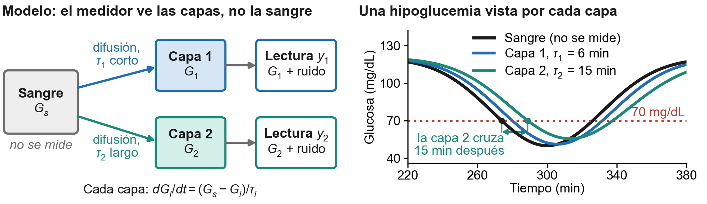
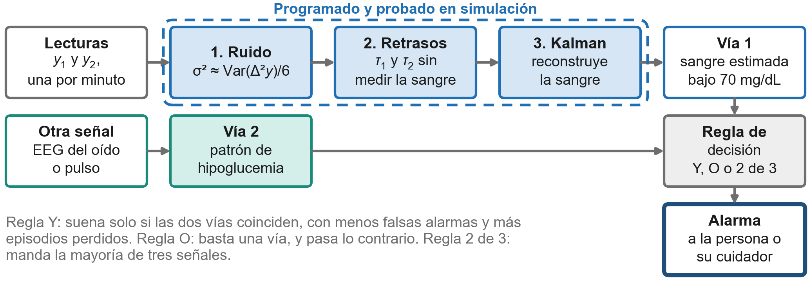

# Entrega del problema

**Cuándo:** viernes 6 de noviembre, bloque 4, en clase. **Peso:** formativa, sin nota. Se devuelve con comentarios.

**Versión para entregar:** [PDF](01-problema-entrega.pdf) y [Word](01-problema-entrega.docx). Es una hoja carta por ambos lados: la página 1 es la entrega y la página 2 es un anexo con el modelo y los algoritmos. Abajo está el mismo texto, para leerlo en GitHub.

## Qué pide la pauta

Media página que responda dos preguntas:

1. Qué problema de salud se aborda.
2. Qué mecanismo del cuerpo humano lo explica.

La entrega ocupa más de media página porque suma el anexo con los diagramas. La página 1 responde las dos preguntas por sí sola.

_Texto redactado con apoyo de IA (Claude) a partir del análisis del repositorio. Las cifras salen de [`../2-simulacion/`](../2-simulacion/) y [`../3-analisis-de-viabilidad/`](../3-analisis-de-viabilidad/)._

## Página 1. La entrega

### 1. El problema

La hipoglucemia nocturna en personas con diabetes que usan insulina. Según el Atlas de Diabetes de la IDF, en 2017 había unos 451 millones de adultos con diabetes en el mundo, y podrían llegar a 693 millones en 2045 (Cho et al., 2018). Mientras duerme, la persona no percibe los síntomas de una glucosa baja y depende de una alarma. Los monitores continuos (CGM) miden la glucosa del líquido intersticial, que va atrasada respecto de la sangre, así que la alarma puede sonar cuando la glucosa en sangre ya bajó. El único monitor no invasivo aprobado por la FDA, GlucoWatch, fracasó en sus alarmas: con la alerta de caída activada, 62 de cada 100 fueron falsas en niños y adolescentes (Tsalikian et al., 2004).

### 2. El mecanismo fisiológico

- **Falla del control (núcleo 2, homeostasis).** La glicemia se regula por retroalimentación negativa: las células del páncreas la detectan y el páncreas endocrino ajusta la insulina y el glucagón. La insulina inyectada queda fuera de ese bucle y sigue actuando aunque la glucosa baje.
- **Aviso que no llega (núcleo 6, sistema nervioso autónomo).** La glucosa baja activa una respuesta simpática, con sudor, temblor y taquicardia, que de día funciona como alarma natural. Durante el sueño esa señal puede pasar inadvertida.
- **Retraso por difusión (núcleo 3, membrana y transporte).** La glucosa sale del capilar al líquido intersticial a favor de su gradiente y entra a las células por los transportadores GLUT. Aplicando la ley de Fick a un volumen de tejido, la glucosa del tejido G sigue a la de la sangre Gs como un sistema de primer orden: dG/dt = (Gs − G)/τ, con τ = V/(P·A), donde P es la permeabilidad del capilar, A el área de intercambio y V el volumen del tejido. Por eso va con varios minutos de atraso (hasta 5 a 10 min según Rebrin et al., 2010), y en una caída rápida ese retraso es justo el tiempo que se pierde.

### 3. Lo que planteamos y lo que ya hicimos

**Idea original.** Medir la glucosa con luz infrarroja media en dos capas de la piel. Como cada capa sigue a la sangre con su propio τ, comparar las dos lecturas permite estimar el retraso de cada persona sin pinchazos y adelantar la alarma. Una segunda vía, el EEG desde el oído, confirmaría la alarma para bajar las falsas, porque la falta de glucosa altera la actividad del cerebro y no depende del sudor.

- **Simulación reproducible, con código público.** La alarma llega entre 5,2 y 14,8 min antes que midiendo una sola capa, siempre que el sensor tenga menos de unos 5,9 mg/dL de ruido por lectura.
- **Análisis de viabilidad sin laboratorio, con criterios fijados antes de ver los datos.** La luz infrarroja media penetra solo unos 45 µm en la piel (Kottmann et al., 2016), y las capas a su alcance separan sus retrasos apenas 0,25 a 7,2 min, cuando el método necesita 9. La alarma combinada con EEG del oído acertaría 54 a 57 de cada 100 veces, bajo las 70 que nos fijamos.
- **Veredicto.** Tal como está, el diseño no supera a GlucoWatch ni a los CGM actuales. Lo presentamos como un resultado del trabajo: sabemos qué falla y por qué.

### 4. Cadena de trazabilidad, estado actual

| # | Casilla | Contenido |
|---|---|---|
| 01 | Problema de salud | Hipoglucemia nocturna en personas con diabetes que usan insulina |
| 02 | Mecanismo | Falla del bucle de control de la glicemia, aviso simpático que se pierde al dormir y retraso por difusión del capilar al líquido intersticial |
| 03 | Contenido | Núcleo 2 (homeostasis), núcleo 3 (membrana y transporte) y núcleo 6 (sistema nervioso autónomo) |
| 04 | Variable medible | Glucosa del líquido intersticial y su retraso respecto de la sangre, en forma continua durante la noche |
| 05 | Transducción | En evaluación. El infrarrojo medio quedó descartado. Propuesta: partir de la medición electroquímica de un CGM y sumar señales no invasivas, como el pulso, para confirmar la alarma |
| 06 | Salida esperada | Alarma nocturna de hipoglucemia para la persona o su cuidador, más temprana y con menos falsas alarmas |

### 5. Lo que nos serviría de su retroalimentación

¿Seguimos por anclar la alarma en un CGM y sumarle biomarcadores (opción B), corregimos el diseño no invasivo con espectroscopía Raman, que hoy tiene la mejor evidencia en personas (opción A), o un resultado negativo bien fundamentado cumple el objetivo del ramo (opción C)?

### Referencias

- Cho, N. H., Shaw, J. E., Karuranga, S., Huang, Y., da Rocha Fernandes, J. D., Ohlrogge, A. W., & Malanda, B. (2018). IDF Diabetes Atlas: Global estimates of diabetes prevalence for 2017 and projections for 2045. *Diabetes Research and Clinical Practice, 138*, 271-281. https://doi.org/10.1016/j.diabres.2018.02.023
- Kottmann, J., Rey, J. M., & Sigrist, M. W. (2016). Mid-infrared photoacoustic detection of glucose in human skin: Towards non-invasive diagnostics. *Sensors, 16*(10), 1663. https://doi.org/10.3390/s16101663
- Rebrin, K., Sheppard, N. F., Jr., & Steil, G. M. (2010). Use of subcutaneous interstitial fluid glucose to estimate blood glucose: Revisiting delay and sensor offset. *Journal of Diabetes Science and Technology, 4*(5), 1087-1098. https://doi.org/10.1177/193229681000400507
- Tsalikian, E., Kollman, C., Mauras, N., Weinzimer, S., Buckingham, B., Xing, D., Beck, R., Ruedy, K., Tamborlane, W., Fiallo-Scharer, R., & DirecNet Study Group. (2004). GlucoWatch G2 Biographer alarm reliability during hypoglycemia in children. *Diabetes Technology & Therapeutics, 6*(5), 559-566. https://doi.org/10.1089/dia.2004.6.559
- Ríos Elgueta, E. A. (2026). *simulacion-retraso-glucosa* [Repositorio con la simulación y el análisis de viabilidad]. GitHub. https://github.com/Stenon5/simulacion-retraso-glucosa

## Página 2. Anexo: el modelo, los algoritmos y cómo se integran las lecturas

**Figura 1.** Modelo de dos capas. Cada capa de tejido sigue a la sangre con su propio retraso τ, y el medidor solo ve las capas. A la derecha, una hipoglucemia simulada con τ1 = 6 min y τ2 = 15 min.

**El modelo.** Cada capa sigue a la sangre con la ecuación de la sección 2 y su propio τ. Despejando, Gs = Gi + τi·dGi/dt: con τ y la pendiente de una capa se podría reconstruir la sangre. Pero τ cambia de una persona a otra y la sangre no se mide, así que el medidor lee dos capas con retrasos distintos y el algoritmo los estima.

**Figura 2.** De las lecturas a la alarma. Los pasos 1 a 3 están programados y probados en simulación. La vía 2 y la regla de decisión se evaluaron con cifras publicadas.

1. **Ruido de cada lectura.** La glucosa cambia de forma suave, así que la segunda diferencia de la serie de lecturas, Δ²y, es casi solo ruido, y en un ruido blanco su varianza vale 6σ². Por eso σ² ≈ Var(Δ²y)/6. En las 280 corridas simuladas recuperó el ruido real con menos de 10 % de error.
2. **Retrasos sin medir la sangre.** Como las dos capas siguen a la misma sangre, G1 + τ1·dG1/dt = G2 + τ2·dG2/dt, y la sangre desaparece. Se integra en vez de derivar, porque derivar amplifica el ruido, y queda ∫(G1 − G2)dt = c − τ1·G1(t) + τ2·G2(t), una ecuación lineal en τ1 y τ2 que se ajusta por mínimos cuadrados. El ruido de las lecturas sesga ese ajuste hacia abajo, y se corrige con el σ del paso 1 (corrección por error en las variables). Si el ajuste queda mal condicionado o da un τ negativo, el método no entrega cifra. Con 2 mg/dL de ruido recuperó τ2 − τ1 = 9,08 ± 0,40 min frente a 9 reales.
3. **Filtro de Kalman.** Su estado es [sangre, pendiente, G1, G2]. Cada minuto predice con el modelo y corrige con las dos lecturas, pesadas según el ruido estimado. Usa solo lecturas pasadas, aunque en la simulación los τ se estimaron antes con la noche completa.
4. **Alarma.** Suena cuando la sangre estimada baja de 70 mg/dL. De aquí sale el adelanto de 5,2 a 14,8 min de la página 1. Con una persona rápida, de retrasos 3 y 6 min, el método falló en 16 de 40 corridas, porque los dos retrasos se parecen demasiado.

**Cómo se integran varias señales.** Hay dos niveles. Al promediar lecturas de glucosa de N sensores, el ruido baja según σf/σ = √((1 + (N − 1)ρ)/N), donde ρ es la correlación entre sus errores, y nunca baja de √ρ. Dos electrodos de un mismo sensor ya tienen ρ ≈ 0,49, así que combinar Raman, infrarrojo medio y una tercera señal dejaría el error medio (MARD) en 13 a 14 %, sobre el 12 % fijado. El segundo nivel combina decisiones con la regla Y, O o 2 de 3 de la figura 2. Como la mediana es de 0,54 hipoglucemias nocturnas por semana, cada falsa alarma pesa mucho, y por eso la vía óptica con EEG del oído, con errores algo dependientes entre sí, acertaría solo 54 a 57 de cada 100 alarmas. Las fuentes y los cálculos de cada cifra están en el repositorio.

**Límites.** Los datos simulados salen del mismo modelo que supone el estimador, así que la simulación prueba que el algoritmo resuelve sus ecuaciones, no que el cuerpo funcione así. Además supone un retraso constante y ruido blanco. Las cifras de alarmas mezclan estudios distintos y sirven para comparar órdenes de magnitud.

## Comentarios recibidos

_Aquí se anotan los comentarios de la profesora cuando se devuelva._
