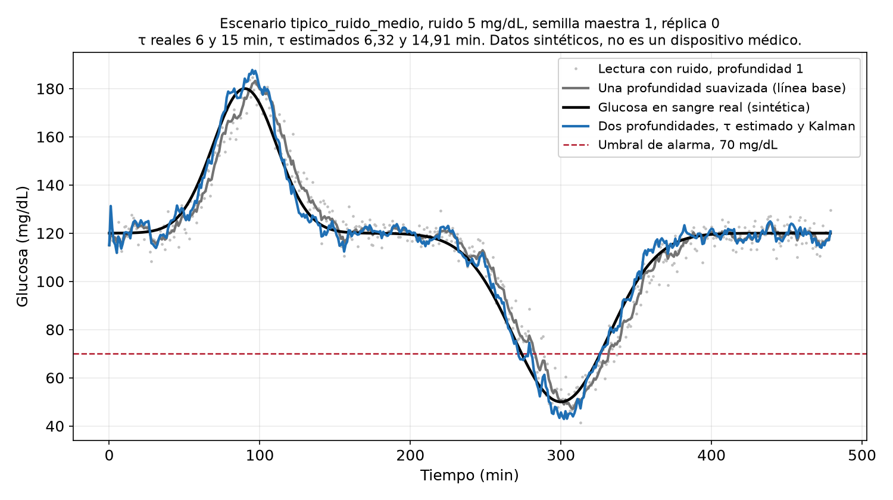

# simulacion-retraso-glucosa

¿Se puede estimar el retraso entre la glucosa en sangre y la glucosa en el
tejido usando solo dos profundidades ópticas, sin ninguna muestra de sangre?
¿Y conocer ese retraso hace que una alarma de hipoglucemia se active antes?

**Estado: primera replicación en simulación, con resultados.** El modelo, el
estimador y el filtro están implementados, y `python run_all.py --seed 1`
regenera de forma idéntica todas las cifras de este README. La replicación no
reproduce las cifras de la corrida exploratoria del 16 de octubre. Los
detalles están en la sección Resultados.



_Un registro sintético del escenario `tipico_ruido_medio` (ruido de 5 mg/dL,
semilla maestra 1, réplica 0). En negro la glucosa en sangre simulada, en gris
una sola profundidad suavizada y en azul la reconstrucción con dos
profundidades, el retraso estimado y el filtro de Kalman. La genera
`src/glucose_delay/figures.py`._

## No es un dispositivo médico

Este repositorio es un estudio de simulación. **No es un dispositivo médico**,
**no diagnostica, no trata ni monitorea ninguna condición**, y **no debe usarse
para decidir nada sobre la salud de nadie**. No hay hardware, ni sensor, ni
mediciones en personas, ni validación clínica. Toda cifra que este código
llegue a producir saldrá de datos sintéticos generados con el modelo descrito
en `docs/especificacion.md`.

## Para qué sirve

Este repositorio es una evaluación de viabilidad en simulación, lo que se llama
un dry lab. Modela un instrumento hipotético que integraría varias mediciones
simultáneas y haría los cálculos, y estudia si esos cálculos podrían funcionar.
El modelado matemático lo hace el autor, sin hardware y con ayuda de IA, que se
registra en [`BITACORA_DE_AGENTES.md`](BITACORA_DE_AGENTES.md).

La idea parte de la revisión de Tang et al. (2020) sobre monitoreo no
invasivo de glucosa, *Sensors* 20(23):6925,
[DOI 10.3390/s20236925](https://doi.org/10.3390/s20236925), estudiada para
un seminario del ramo.

No propone una técnica nueva. Junta conceptos que ya existen, como la selección
de profundidad, la estimación del retraso entre compartimentos y los filtros de
estado. Lo que se estudia es qué modelos matemáticos sirven mejor para combinar
mediciones de distintos aparatos. Hoy el repositorio cubre un primer caso, dos
profundidades con un estimador y un filtro. Comparar otras familias de modelos
es el [issue 18](https://github.com/Stenon5/simulacion-retraso-glucosa/issues/18).

Se habla de evaluar la viabilidad y no de validar, porque con datos sintéticos
generados por el mismo modelo que supone el estimador no hay validación contra
un cuerpo real.

## La pregunta, planteada de modo que pueda fallar

Dos profundidades de medición ven la misma señal de glucosa en sangre a través
de dos retrasos de difusión de primer orden distintos. Lo que se pone a prueba
es si esas dos señales retrasadas bastan para identificar ambos retrasos, sin
medir nunca la glucosa en sangre.

Los umbrales de aprobado y reprobado están fijados en
[`umbrales.yaml`](umbrales.yaml) y quedaron en el repositorio antes de que
existiera el código que los revisa. No se editan después de ver un resultado.
Una enmienda va en un archivo nuevo.

Una aclaración. Los umbrales se eligieron después de una corrida exploratoria
anterior (2026-10-16) cuyos scripts no están en este repositorio. Este
repositorio es la replicación, así que los umbrales se fijaron antes de la
replicación y no antes de que la idea se probara por primera vez.

## Lo que esto NO es

* No es un dispositivo, ni un prototipo, ni hardware.
* No es una validación de ninguna tecnología de medición. Supone que existe un
  sensor y pregunta qué nivel de ruido tendría que alcanzar ese sensor para
  que el método sirva de algo.
* No es evidencia de exactitud en una persona. Con datos sintéticos generados
  por el mismo modelo que supone el estimador, lo único que se verifica es que
  el estimador resuelve sus propias ecuaciones. Eso no es una validación.

Este último punto es la principal limitación de todo el diseño, y es la razón
de que exista `docs/barridos-de-mala-especificacion.md`.

## Por qué un resultado negativo es el resultado útil

El método solo ayuda si el sensor es lo bastante silencioso. Si el ruido
necesario por lectura está por debajo de lo que la medición óptica ha
demostrado alcanzar, la conclusión honesta es un límite: el cuello de botella
no es el algoritmo, es el hardware. Ese límite es el entregable, sea o no
alentador.

Como referencia del lado del hardware, un estudio in vitro con un láser de
cascada cuántica informó una concentración de glucosa equivalente al ruido de
4 mg/dL, con una potencia media de 1,8 mW y un tiempo de integración de 50 s
(Vrančić C et al., *Analyst* 2011, 136:1192,
DOI [10.1039/C0AN00537A](https://doi.org/10.1039/C0AN00537A)). Es una cifra in
vitro para un montaje específico. No se ha demostrado nada equivalente en una
persona.

## Regla para informar

El sesgo nunca se informa solo. Cada sesgo se informa junto a la desviación
estándar entre corridas, para cada escenario. Un sesgo medio que parece
pequeño puede esconder una dispersión varias veces mayor, y un solo número
promediado lo oculta. Esta regla está en `umbrales.yaml` y aplica al README,
al informe y a cualquier figura.

## Resultados

Cada escenario tiene 40 réplicas. Media y DE sobre las corridas válidas, es
decir, sin constante negativa ni casos no identificables. Los datos por semilla
están en `results/` y el resumen completo en [`results/resumen.md`](results/resumen.md).

| Escenario | Retraso real 1 | Retraso estimado 1, media y DE | Retraso real 2 | Retraso estimado 2, media y DE | Nivel de ruido |
|---|---|---|---|---|---|
| `tipico_ruido_bajo` | 6 min | 6,21 ± 1,10 min | 15 min | 15,29 ± 1,32 min | 2 mg/dL |
| `tipico_ruido_medio` | 6 min | 6,73 ± 3,00 min | 15 min | 15,98 ± 3,48 min | 5 mg/dL |
| `tipico_ruido_alto` | 6 min | 9,24 ± 7,00 min | 15 min | 18,85 ± 7,67 min | 8 mg/dL |
| `persona_lenta` | 15 min | 16,16 ± 3,85 min | 30 min | 31,58 ± 4,79 min | 5 mg/dL |
| `persona_rapida` | 3 min | 7,51 ± 9,01 min | 6 min | 10,92 ± 9,33 min | 5 mg/dL |
| `replica_persona_lenta` | 12 min | 12,71 ± 2,69 min | 30 min | 31,09 ± 3,58 min | 5 mg/dL |
| `replica_persona_rapida` | 3 min | 5,33 ± 4,13 min | 8 min | 10,65 ± 4,35 min | 5 mg/dL |

DE es la desviación estándar entre semillas.

Lo principal:

* La diferencia entre los dos retrasos se recupera con precisión, por ejemplo
  9,08 ± 0,40 min frente a 9 reales con ruido de 2 mg/dL. Lo que queda mal
  identificado es el nivel de cada retraso por separado, con una cola hacia
  valores altos.
* En los escenarios difíciles el estimador falla en parte de las corridas, con
  una constante negativa o un caso no identificable: 3 de 40 con ruido de
  8 mg/dL, 7 de 40 en la réplica de la persona rápida y 16 de 40 en la persona
  rápida.
* La alarma de hipoglucemia se activa antes que con una sola profundidad, en
  promedio entre 5,2 y 14,8 min según el escenario. Con ruido de 8 mg/dL y en
  la persona rápida aparecen falsas alarmas.
* El método supera a una sola profundidad hasta unos 5,9 mg/dL de ruido por
  lectura. Esa cifra sale de solo tres niveles de ruido y depende del diseño
  de la línea base.

Umbrales de [`umbrales.yaml`](umbrales.yaml), por escenario, en
[`results/registro-de-umbrales.json`](results/registro-de-umbrales.json):

* **Sesgo menor a 1 min:** se cumple solo en la persona típica con ruido de 2 y
  5 mg/dL, y con 5 mg/dL la dispersión es varias veces mayor que el sesgo.
* **Alarma más temprana sin más falsas alarmas:** 5 de 7 escenarios.
* **Mejor que un retraso poblacional fijo:** 3 de 7. En la persona típica no se
  puede ganar, porque ese retraso fijo coincide con el real.
* **Ruido estimado y requisito de ruido:** se cumplen en todos.

### Frente a la corrida exploratoria

La replicación no reproduce las cifras del 16 de octubre, y manda la
replicación. Las desviaciones salen entre 2 y 2,6 veces mayores, el sesgo llega
a 3,85 min en vez de 0,8 o menos, y el requisito de ruido sale en unos
5,9 mg/dL en vez de 2 a 3. La comparación completa está en
[`results/comparacion-con-corrida-exploratoria.md`](results/comparacion-con-corrida-exploratoria.md),
y las decisiones de implementación, escritas antes de correr, en
[`docs/decisiones-de-implementacion.md`](docs/decisiones-de-implementacion.md).

## Cómo ejecutarlo

```
python -m pip install -e ".[dev]"
python run_all.py --seed 1
```

`run_all.py` escribe un CSV por escenario y el resumen en `results/`, la
figura en `figures/` y el registro de umbrales. Las pruebas que siguen
omitidas corresponden a trabajo de fases posteriores.

## Limitaciones

Escritas antes de que este repositorio produzca cualquier resultado, porque se
desprenden del diseño.

* **Circularidad.** Los datos sintéticos se generan con el mismo modelo de
  difusión de primer orden que supone el estimador. Recuperar el retraso en
  esas condiciones verifica el estimador. No valida el modelo frente a un
  cuerpo real.
* **Retraso constante.** El retraso se mantiene fijo. La perfusión cambia con
  el ejercicio, la temperatura y la postura.
* **Ruido blanco.** Sin deriva y sin correlación entre las dos profundidades.
  En sensores ópticos reales la deriva lenta suele dominar el error, y dos
  profundidades del mismo instrumento compartirían parte de su ruido.
* **Un solo día sintético.** Un registro sintético corto con una sola
  excursión hipoglucémica no es un día de vida con diabetes.
* **El retraso informado en personas varía.** Las estimaciones publicadas del
  retraso entre sangre e intersticio no son un número único, así que usar un
  único valor real en una simulación es una comodidad, no un dato sobre nadie.
* **No hay sensor.** El nivel de ruido es una entrada, no algo medido.

## Lo que falló

Intentos reales, con lo que enseñó cada uno. Las entradas completas, incluidas
las cifras una vez que el código de este repositorio pueda reproducirlas,
están en [`BITACORA_DE_AGENTES.md`](BITACORA_DE_AGENTES.md).

* La regresión sobre las derivadas de las dos señales entregó una constante de
  tiempo negativa, lo que es físicamente imposible. Derivar una señal ruidosa
  pasó el ruido a la matriz de diseño.
* La forma integral corrigió el signo y recuperó la diferencia entre los dos
  retrasos, pero subestimó ambos. La información que distingue un retraso del
  otro está en la pequeña diferencia entre las dos lecturas, y el ruido diluye
  justamente eso.
* Corregir el error en las variables abordó ese sesgo. Esta es la versión que
  describe `docs/especificacion.md`.

## Siguiente paso, sin necesidad de hardware

Antes que cualquier otra cosa, los barridos de mala especificación de
[`docs/barridos-de-mala-especificacion.md`](docs/barridos-de-mala-especificacion.md):
retraso variable, ruido correlacionado entre profundidades, deriva del sensor
y cinéticas que no son de primer orden. La idea es encontrar dónde se rompe el
estimador y publicarlo.

Solo después de eso tiene algún valor usar curvas de glucosa más realistas
sacadas de un simulador de diabetes tipo 1 de código abierto. Un candidato es
simglucose (<https://github.com/jxx123/simglucose>, licencia MIT), cuyo README
lo describe como una implementación en Python del simulador UVa/Padova,
versión 2008, para uso en investigación. Eso es una descripción del paquete,
no una afirmación sobre su situación regulatoria, y que el paquete sea de
código abierto no elimina por sí solo el problema de circularidad.

## Estructura del repositorio

```
docs/especificacion.md                    el modelo y el estimador, con detalle suficiente para implementarlos
docs/barridos-de-mala-especificacion.md   dónde se espera que se rompa el estimador
docs/backlog-de-issues.md                 la lista de tareas, lista para abrir como issues
umbrales.yaml                             criterios de aprobado y reprobado, registrados primero
run_all.py                                punto de entrada, regenera todo
src/glucose_delay/                        paquete con el modelo, el estimador y el filtro
tests/                                    tests, omitidos hasta que exista el código
results/                                  resultados por escenario y resumen
figures/                                  figura del registro representativo
informe/factibilidad.md                   la estructura del informe, sin rellenar
BITACORA_DE_AGENTES.md                    en qué se equivocó el flujo de trabajo asistido por agentes
```

## Licencia

El código es MIT, ver [`LICENSE`](LICENSE). El informe, los documentos y
cualquier dato generado están bajo CC BY 4.0, ver
[`LICENCIA-DATOS.md`](LICENCIA-DATOS.md).

## Cómo citar

Ver [`CITATION.cff`](CITATION.cff).
